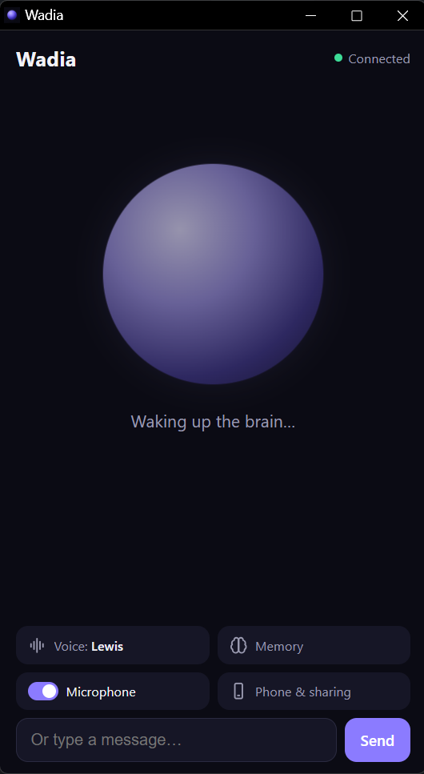

# 🎙️ Wadia: an offline voice assistant in Python

[](https://github.com/AleexWadee/Wadia/actions/workflows/tests.yml)

Wadia is a voice assistant like Siri or Alexa that runs **entirely on a laptop**. Speech recognition, the language model and the voice all run locally, with no account, no API key and no cost. Only web searches, the pages it reads and weather lookups go to the internet.

You say "Hey Wadia, what's the weather?" and it starts answering **about two seconds after you stop talking**. It remembers past conversations, speaks English and Spanish, searches the web live, and has a phone app and a guest mode so other people can try it without seeing anything private.

I built it in my free time. I first wanted to train my own model, but my laptop didn't have enough memory, so I switched to running an open model locally (Qwen via Ollama) and giving it tools: web search, page reading, weather, a calculator and long-term memory.

<p align="center">
  
</p>

## Highlights

- **Fully local voice pipeline:** voice activity detection → speech-to-text on the GPU → local LLM with tool calling → text-to-speech on the CPU, fitting in 8 GB of GPU memory.
- **Low latency through streaming:** the LLM's answer is spoken sentence by sentence while it's still being written. The first piece is cut early, at a comma, so Wadia starts talking sooner ([`brain.py`](local/brain.py)).
- **Tool calling:** the model decides by itself when to search the web, read a page, check the weather, get the time, do maths or search old conversations ([`tools.py`](local/tools.py)). The calculator walks the Python AST instead of using `eval`, so it's safe.
- **Long-term memory:** it learns facts about the user, summarises each conversation, reads the last 8 summaries every time, and searches older conversations on request ([`history.py`](local/history.py)).
- **One backend, several apps:** an `aiohttp` server with WebSockets serves the laptop window and an installable phone web app ([`server.py`](local/server.py)).
- **Safe sharing:** a public HTTPS link through Tailscale Funnel or a Cloudflare quick tunnel ([`sharing.py`](local/sharing.py)). Testers get a **guest mode**: random access codes compared in constant time, conversations not saved, and no access to the owner's memory, location or settings.

## How it works

```
 microphone ──► Silero VAD ──► faster-whisper ──► Ollama (Qwen + Wadia persona) ──► Kokoro TTS ──► speaker
               (is someone     (speech to text,    (answer, tool calls,             (natural voice,
                talking?)       language detection)  memory)                          sentence by sentence)
```

| Step | Technology |
| --- | --- |
| Hearing | [Silero VAD](https://github.com/snakers4/silero-vad) detects speech, and [faster-whisper](https://github.com/SYSTRAN/faster-whisper) (`large-v3-turbo`) turns it into text on the GPU and detects the language. |
| Thinking | The `wadia` model in [Ollama](https://ollama.com): Qwen 3.5 9B plus Wadia's personality ([`persona.txt`](local/persona.txt)), tools and memory. |
| Speaking | [Kokoro](https://huggingface.co/hexgrad/Kokoro-82M), a natural-sounding voice model that runs on the CPU. |

The laptop does all the work. The phone app sends your voice to the laptop and plays back the answer.

Speaking while the answer is still streaming, from [`local/brain.py`](local/brain.py):

```python
def sentences_from_stream(token_stream):
    """Groups streamed LLM tokens into sentences to speak. The first piece is cut early,
    at a comma once there are a few words, so Wadia starts talking sooner."""
    buffer, first = "", True
    for token in token_stream:
        buffer += token
        while True:
            match = re.search(r"(?<=[.!?])\s+|\n+", buffer)
            if first and not match:
                match = next(
                    (c for c in re.finditer(r"(?<=[,;:])\s+", buffer) if len(buffer[: c.start()].split()) >= 5), None
                )
            if not match:
                break
            piece, buffer = buffer[: match.start()], buffer[match.end() :]
            ...
```

## What it can do

- **Wake word.** It sleeps until you say "Wadia", then keeps listening for a few seconds after answering so you can ask a follow-up. "That's all" or "Goodbye" puts it to sleep.
- **Your language.** Speak English or Spanish (also French, Italian or Portuguese) and it answers in the same language with a matching voice.
- **Live information.** For news, scores and prices it searches the web live, combining several search engines, reads the top pages and answers in a sentence or two.
- **Voices.** More than 35 voices, blending two voices into a new one, and speed control. You can also just say "Use a male voice".
- **Memory you control.** See, add or delete what Wadia knows about you and every past conversation from the **Memory** screen, or say "Forget that I like Formula 1".
- **Knows where you are.** "Will it rain today?" works without naming a place.
- **Laptop app** with a glowing orb, a tray icon, a microphone switch and "Start with Windows". **Phone app** installable from a QR code, with hands-free mode.

## Code tour

| File | Purpose |
| --- | --- |
| [`local/app.py`](local/app.py) | The laptop app: window, tray icon, and starting everything up. |
| [`local/assistant.py`](local/assistant.py) | The laptop assistant loop: wake word, listening and speaking. |
| [`local/brain.py`](local/brain.py) | Conversation with the LLM, tool calls, streaming into sentences, memory, sleep phrases. |
| [`local/speech.py`](local/speech.py) | Speech detection, speech recognition, voices and voice blends. |
| [`local/tools.py`](local/tools.py) | Web search and page reading, weather, date and time, calculator, settings and memory storage. |
| [`local/history.py`](local/history.py) | Saving, summarising and searching past conversations. |
| [`local/location.py`](local/location.py) | Finding the user's location (automatic, typed, or from the phone). |
| [`local/server.py`](local/server.py) | The backend for both apps: WebSockets, access codes, guest mode, HTTPS for the phone. |
| [`local/sharing.py`](local/sharing.py) | The public link (Tailscale Funnel, or a Cloudflare quick tunnel as a fallback). |
| [`local/web/`](local/web) | The app screen shared by the laptop and the phone, icons and installable-app files. |
| [`local/shortcuts.py`](local/shortcuts.py) | Desktop, Start menu and "Start with Windows" shortcuts. |
| [`local/persona.txt`](local/persona.txt) | Wadia's personality and rules. |
| [`local/create_model.py`](local/create_model.py) | Builds the `wadia` model in Ollama from a base model plus the personality. |
| [`elevenlabs/`](elevenlabs) | An alternative cloud version built on the ElevenLabs API (see below). |
| [`Wadia.bat`](Wadia.bat) | Starts Wadia with a troubleshooting console. |

I also built Android wrapper apps (an owner app and a "Try-out" guest app). They're not in this repository because they contain my signing key and my laptop's address.

## Run it yourself (Windows)

You need an NVIDIA GPU with 8 GB of memory (or use the smaller model below), [Ollama](https://ollama.com/download) and Python 3.12 or newer.

1. Install the Python packages and download the voice model (about 350 MB):

   ```powershell
   py -m venv .venv
   .\.venv\Scripts\activate
   pip install -r local\requirements.txt
   mkdir local\voices
   curl.exe -L -o local\voices\kokoro-v1.0.onnx https://github.com/thewh1teagle/kokoro-onnx/releases/download/model-files-v1.0/kokoro-v1.0.onnx
   curl.exe -L -o local\voices\voices-v1.0.bin https://github.com/thewh1teagle/kokoro-onnx/releases/download/model-files-v1.0/voices-v1.0.bin
   ```

2. Build the `wadia` model. The first time, this downloads Qwen 3.5 9B (6.6 GB):

   ```powershell
   python local\create_model.py
   ```

   On a graphics card with less than 8 GB of memory, use the lighter model: `python local\create_model.py qwen3.5:4b`

3. Create the shortcuts, then open **Wadia** from the Desktop. The first run downloads the Whisper model (about 1.6 GB).

   ```powershell
   python local\shortcuts.py
   ```

Close games and other GPU-heavy programs first, and use headphones if Wadia hears itself through the speakers.

### Settings

Most settings are in the app. These can also be set in `Wadia.bat` or as environment variables:

| Setting | Default | Description |
| --- | --- | --- |
| `MIC_DEVICE` | Windows default | Part of a microphone's name (for example `Intel`) or its number. |
| `PHONE` | `on` | `off` disables the phone app. |
| `PHONE_PORT` | `8443` | Port for the phone app on the Wi-Fi. |
| `PUBLIC_PORT` | `8766` | Local port the public link forwards to. |
| `DESKTOP_PORT` | `8765` | Port for the laptop window (only reachable from the laptop). |
| `LLM_MODEL` | `wadia` | Any Ollama model that supports tools. |
| `WHISPER_MODEL` | `large-v3-turbo` | `small` is lighter and faster, but less accurate. |
| `WHISPER_DEVICE` | `auto` | GPU if it works, CPU otherwise. Can be forced to `cuda` or `cpu`. |

## Tests

The [`tests/`](tests) folder checks the logic that doesn't need the models: the safe calculator (correct results, and rejecting code injection or huge exponents) and how the streamed answer is cut into sentences to speak. They run automatically on GitHub with every push, and locally with:

```powershell
pip install pytest
pytest
```

## Privacy

Everything Wadia remembers is stored only on the laptop, in `local/memory.json`, `local/settings.json` and `local/history/`. These files, the security certificates and any API keys are kept out of Git by [`.gitignore`](.gitignore). To detect the location automatically, Wadia asks free services ([GeoJS](https://www.geojs.io), [ipwho.is](https://ipwho.is), [ipapi](https://ipapi.co)) where the internet connection is; nothing else is sent.

## Alternative: ElevenLabs version

The [`elevenlabs/`](elevenlabs) folder holds a second version built on the ElevenLabs API, where speech recognition, the reply and the voice all run in the cloud. It needs a free ElevenLabs account: copy `elevenlabs/.env.example` to `elevenlabs/.env`, add your API key, run `python elevenlabs\create_agent.py` once, and then `python elevenlabs\assistant.py`.

---

Made by [Alejandro Wade Montesdeoca](https://github.com/AleexWadee).
